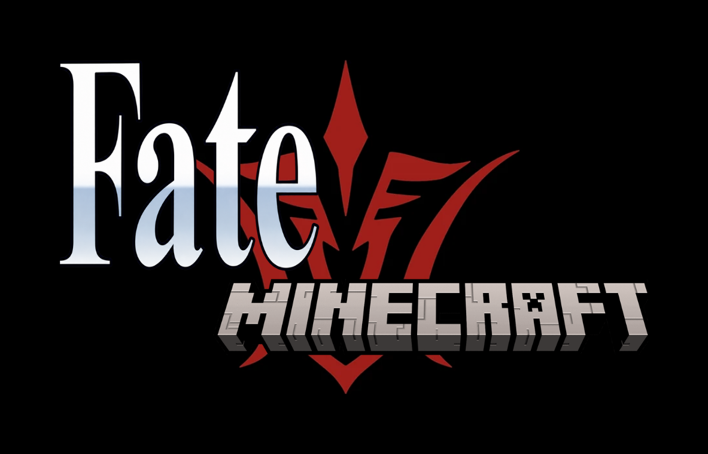

<p align="center"></p>

[](https://www.minecraft.net/)
[](https://fabricmc.net/)
[](https://adoptium.net/)
[](#license)

Fatecraft is a Minecraft mod heavily inspired by the Fate franchise, built on [Alaya Core](https://github.com/CWZMorro/AlayaCore).
Playable now: Artoria, Gilgamesh, EMIYA and Altera.

Beta version (0.1.0). Most items are only available from the creative menu for now.

Releases: [GitHub Releases](https://github.com/CWZMorro/Fatecraft/releases).

## Requirements

- Minecraft 26.1.2
- Fabric Loader 0.19.5 or newer
- Fabric API 0.155.3+26.1.2
- [Alaya Core](https://github.com/CWZMorro/AlayaCore) 0.2.0 or newer
- Java 25

## Building

Fatecraft builds against Alaya Core's source, which must sit next to it as `alaya-core`:

```bash
git clone https://github.com/CWZMorro/AlayaCore.git alaya-core
git clone https://github.com/CWZMorro/Fatecraft.git fatecraft
cd fatecraft
./gradlew build
```

The jar is in `build/libs/`.

## Contributing

Report bugs and suggest features in [Issues](https://github.com/CWZMorro/Fatecraft/issues). Pull requests are welcome.

Please follow these guidelines:

1. Fork the repository
2. Create a feature branch (`git checkout -b feature/amazing-feature`)
3. Make your changes
4. Ensure tests pass and code is properly formatted
5. Commit your changes using [conventional commit message](https://www.conventionalcommits.org/en/v1.0.0/)
6. Push to the branch (`git push origin feature/amazing-feature`)
7. Open a Pull Request

## Help wanted

I need help with models and textures for weapons and custom entities. If you know GeckoLib or Blockbench and are willing to help, contact me by [email](mailto:cwzmorro@gmail.com).

## Contact

To contact me: [cwzmorro@gmail.com](mailto:cwzmorro@gmail.com)

## Credits

- An unofficial fan work. Fate belongs to TYPE-MOON. Not affiliated with TYPE-MOON, Aniplex, Lasengle or Mojang.
- Ea's model is converted from
  ["Sword of Rupture, Enuma Elish (乖離剣 / EA)"](https://sketchfab.com/3d-models/sword-of-rupture-enuma-elish-ea-551a02ec36b949cb93c2b6579f4d9016)
  by Ophelie Juarez (@SakuraKato), [CC BY 4.0](https://creativecommons.org/licenses/by/4.0/), modified.

## License

All rights reserved. You may play it, learn from the code, send pull requests and include it in modpacks with credit and a link; re-uploading the jar elsewhere needs my permission. Ea's model: [CC BY 4.0](https://creativecommons.org/licenses/by/4.0/).
